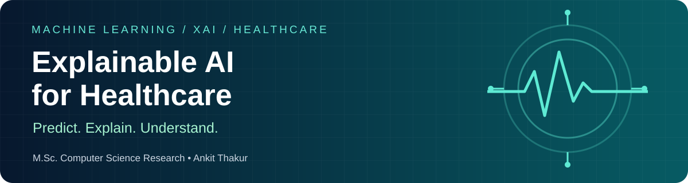
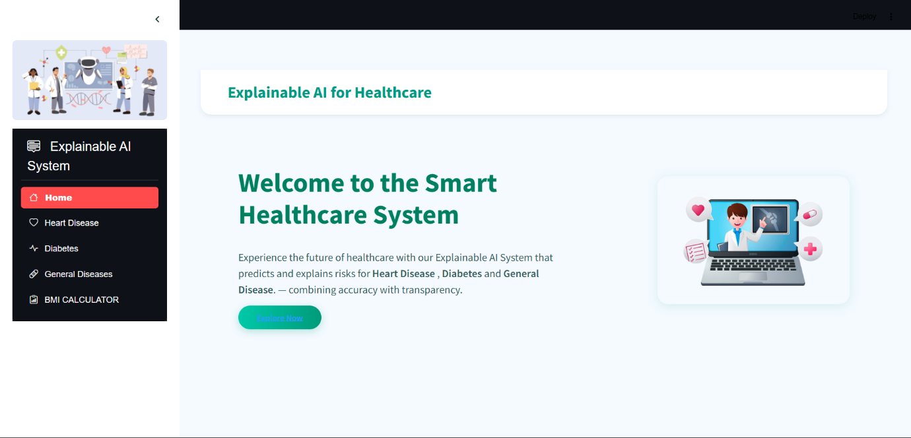
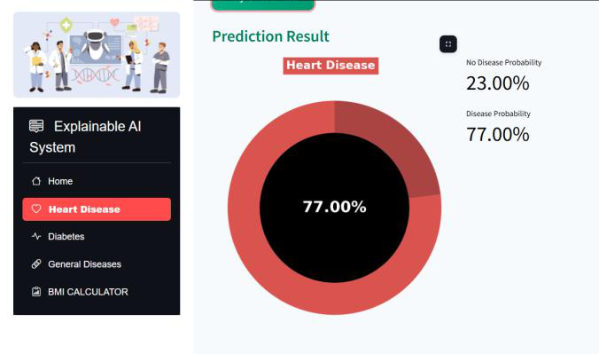
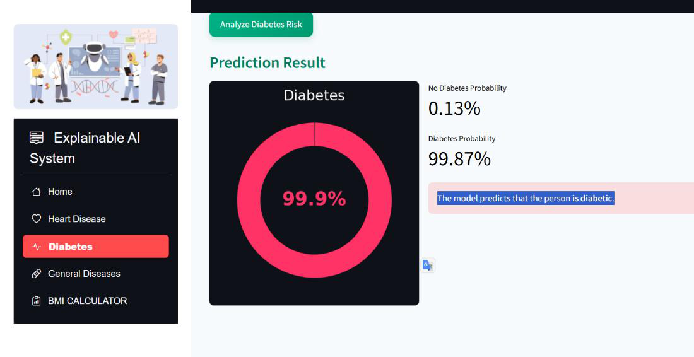
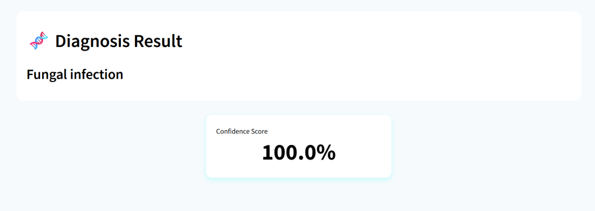
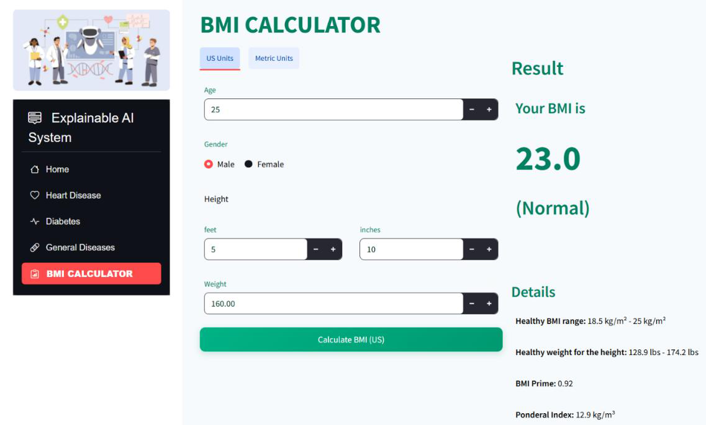
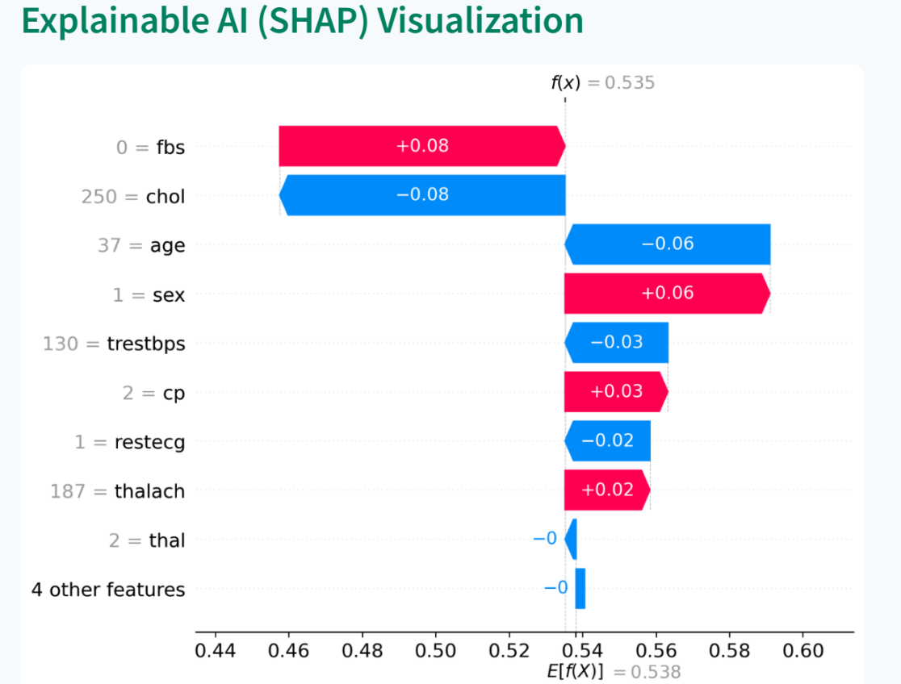
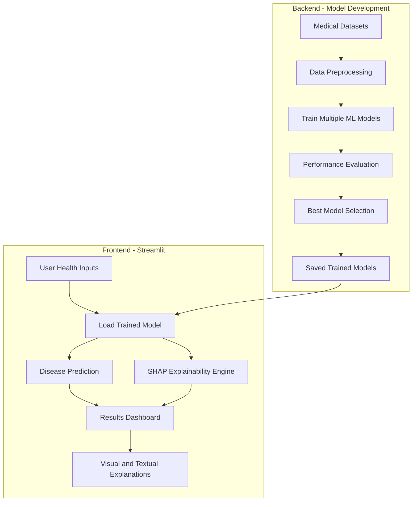

<div align="center">



<br>

[](https://explainable-ai-for-healthcare-user-509w.onrender.com/)
[](#-research-information)


[Overview](#-overview) · [Application](#-application-gallery) · [Architecture](#-system-architecture) · [Results](#-experimental-results) · [Setup](#-getting-started)

</div>

<table><tr>
<td align="center" width="33%"><h2>90.16%</h2><b>Heart Disease</b><br>Random Forest</td>
<td align="center" width="33%"><h2>97.14%</h2><b>Diabetes</b><br>CatBoost</td>
<td align="center" width="33%"><h2>100%</h2><b>General Illness</b><br>Random Forest</td>
</tr></table>

<p align="center"><sub>Reported experimental accuracy • Not clinical validation</sub></p>

## 🖥️ Application gallery

<div align="center"></div>

<table><tr><td width="50%" align="center"><b>Heart Disease Prediction</b><br></td><td width="50%" align="center"><b>Diabetes Prediction</b><br></td></tr><tr><td align="center"><b>General Illness Prediction</b><br></td><td align="center"><b>BMI Calculator</b><br></td></tr></table>

<details><summary><b>Explore SHAP waterfall visualization</b></summary>



</details>

---

## 📌 Overview

Traditional machine learning systems can predict diseases but often fail to explain why a particular prediction was made. This lack of transparency is especially important in healthcare.

**Explainable AI for Healthcare** combines supervised machine learning with SHAP (SHapley Additive exPlanations) to provide disease predictions alongside interpretable visual and textual explanations. The project integrates three prediction modules and a BMI calculator into an interactive Streamlit application.

## ✨ Key features

- ❤️ **Heart disease prediction** using clinical and demographic parameters.
- 🩸 **Diabetes prediction** using glucose, HbA1c, BMI and other health indicators.
- 🩺 **General illness prediction** across 41 disease classes using symptom-based inputs.
- 🧠 **Explainable AI** with local and global SHAP explanations.
- 📊 Interactive prediction scores, feature contribution plots and textual explanations.
- ⚖️ Integrated BMI calculator.
- 🌐 Web-based interface for real-time inference.
- 🔬 Comparative evaluation of classical and ensemble machine learning algorithms.

## 🏗️ System architecture



## 📂 Datasets

| Dataset | Samples | Input features | Task |
|---|---:|---:|---|
| [UCI Heart Disease](https://www.kaggle.com/datasets/redwankarimsony/heart-disease-data) | 303 | 13 | Binary classification |
| [Diabetes Prediction](https://www.kaggle.com/datasets/iammustafatz/diabetes-prediction-dataset) | 100,000 | 8 | Binary classification |
| [General Illness](https://www.kaggle.com/datasets/kaushil268/disease-prediction-using-machine-learning) | 4,920 | 131 | 41-class classification |

Dataset sizes and feature counts are reported in the dissertation; target variables are excluded from the input feature counts.

## 🤖 Machine learning algorithms

| Classical models | Tree-based and ensemble models |
|---|---|
| Logistic Regression | Decision Tree |
| Gaussian Naïve Bayes | Random Forest |
| Support Vector Machine | XGBoost |
| K-Nearest Neighbors | LightGBM |
| | CatBoost |
| | Voting Classifiers |

## 📈 Experimental results

The final models were selected through comparative evaluation using accuracy, precision, recall, F1-score and confusion matrices.

| Prediction module | Selected model | Accuracy | Precision | Recall | F1-score |
|---|---|---:|---:|---:|---:|
| Heart Disease | Random Forest | **90.16%** | 0.91 | 0.89 | 0.90 |
| Diabetes | CatBoost | **97.14%** | 0.9434 | 0.7059 | 0.8075 |
| General Illness | Random Forest | **100%** | 1.00 | 1.00 | 1.00 |

> These are dissertation-reported experimental results on the evaluated datasets, not clinically validated performance. The perfect general illness score requires independent validation and checks for data leakage or duplicate samples. Diabetes recall also highlights a limitation despite high accuracy.

## 🧠 Explainable Artificial Intelligence (XAI)

SHAP attributes a model prediction to its individual input features using a game-theoretic approach.

| Explanation | Purpose |
|---|---|
| Summary plot | Global feature importance and direction of influence |
| Bar plot | Ranking of influential features |
| Force plot | Contributions that push predictions higher or lower |
| Waterfall plot | Feature-wise explanation of an individual prediction |
| Textual explanation | Human-readable interpretation of model contributions |

SHAP explains model behavior, not medical causality. The system supports both global and individual prediction explanations.

## 🖥️ Application modules

| Module | Functionality |
|---|---|
| Heart Disease | Clinical inputs, prediction scores and SHAP explanations |
| Diabetes | Health indicators, donut-chart results and SHAP explanations |
| General Illness | Symptom selection, predicted class and confidence score |
| BMI Calculator | Basic body mass index assessment |


## 🛠️ Technology stack

- **Language:** Python
- **Machine learning:** Scikit-learn, XGBoost, LightGBM, CatBoost
- **Explainability:** SHAP
- **Frontend:** Streamlit
- **Model persistence:** Pickle (.pkl)
- **Deployment:** Render (live demo listed in the dissertation)

## 🚀 Getting started

### 1. Clone the repository

```bash
git clone https://github.com/Ankitthakur2025/-Explainable-AI-for-Healthcare-User-Interface.git
cd -- -Explainable-AI-for-Healthcare-User-Interface
```

### 2. Create a virtual environment

```bash
python -m venv .venv
```

Windows PowerShell:

```powershell
.\.venv\Scripts\Activate.ps1
```

Linux / macOS:

```bash
source .venv/bin/activate
```

### 3. Install dependencies

If the repository contains a `requirements.txt` file:

```bash
pip install -r requirements.txt
```

### 4. Run the application

If the Streamlit entry point is `app.py`:

```bash
streamlit run app.py
```

Adjust the repository URL, entry point, model paths and dependency versions to match the actual repository. Ensure the required trained models are available before launching the application. Only load trusted pickle files.

## 🔮 Future scope

- Extend the system to additional disease categories and more diverse datasets.
- Incorporate clinical notes, wearable sensor data and real-time vitals.
- Explore LSTM and transformer-based models.
- Integrate LIME, counterfactual explanations and feature interaction analysis.
- Collaborate with healthcare professionals for external clinical validation.

## 🎓 Research information

| | |
|---|---|
| Dissertation | Explainable AI for Healthcare |
| Author | Ankit Thakur |
| Degree | M.Sc. Computer Science |
| Supervisor | Prof. Sandeep Paul |
| Institution | Dayalbagh Educational Institute, Agra, India |
| Submission | December 2025 |

### Reference

Lundberg, S. M., & Lee, S.-I. (2017). [A Unified Approach to Interpreting Model Predictions](https://arxiv.org/abs/1705.07874).

## ⚠️ Medical disclaimer

This project is an academic research prototype intended for educational and research purposes. It is not a medical device, does not provide a confirmed diagnosis, and must not replace professional medical advice or treatment. Do not enter identifiable patient information into a public demonstration.

## 👨‍💻 Author

**Ankit Thakur** — Machine Learning & Explainable AI

[](https://github.com/Ankitthakur2025)

---

<div align="center">

**Making machine learning more transparent, interpretable and understandable.**

⭐ If you find this research useful, consider starring the repository.

</div>
